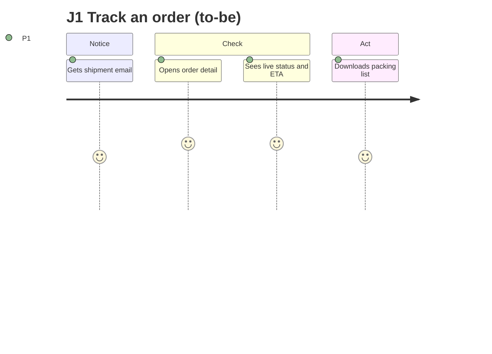

# Phase 4: User journey mapping

**Goal:** Map each persona's complete experience, including what happens outside
the product, so the design fixes real pain points instead of only digitising steps.

**Done when:** Every persona has at least one journey for each of their main goals,
with pain points and opportunities identified at every stage.

## How to run it

1. List each persona's main goals (from phase 3). Each goal becomes a journey
   (J1, J2...). Confirm the list with the person.
2. For each journey, describe today's experience (the "as-is") first, then the
   improved experience the product should create (the "to-be").
3. Keep journeys at the level of stages, not screens. Screens come in phase 6.

## Per journey, capture

- **Trigger:** what starts the journey (an email, a deadline, a phone call).
- **Stages:** usually 4 to 7, covering before, during and after product use.
- **Per stage:** what the person does, what they think, how they feel (frustrated,
  anxious, satisfied), touchpoints (email, phone, other systems, people).
- **Pain points** at each stage.
- **Opportunities:** how the product could remove or reduce each pain point.
- **Moments that matter:** the stages where getting it wrong loses trust.
- **End:** how the person knows they're done.

## Question areas

- What happens right before they open the product? Right after they close it?
- Where do they wait, and for whom? How do they find out the wait is over?
- Where do they need information from someone else today?
- Where do mistakes happen, and how are they discovered?
- What notifications do they need, through which channel (in-app, email, SMS,
  WhatsApp), and how often before it becomes noise?
- Cross-role handoffs: when the journey passes to another persona, what does each
  side need to know?

## Diagram

Use a Mermaid `journey` diagram per journey for the to-be version, plus a table with
pain points and opportunities per stage. Example:

## Spec section 4 structure

4.1 Journey list (ID, persona, goal) · 4.2 Each journey: trigger, as-is summary,
to-be diagram, stage table (actions, thoughts, feelings, pain points,
opportunities) · 4.3 Moments that matter · 4.4 Notification needs
