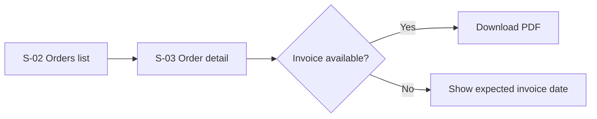

# Phase 6: Task and user flows

**Goal:** Define the exact steps for every task, including decisions, alternate
paths and failures, and derive the complete list of screens.

**Done when:** Every task from the journeys has a flow, every flow has its happy path,
branches and error paths, and every step maps to a screen ID in the screen inventory.

## Step 1: Task list

From the journeys, list every task per persona. For each task, record:
- Frequency (daily, weekly, rare) and criticality (what breaks if it fails).
- Which role performs it.

Confirm the list, and ask what tasks are missing (admin, setup, account, error
recovery and one-off tasks are often forgotten). Every listed task gets a flow.

## Step 2: For each flow (F-01, F-02...)

- **Entry points:** every way the user can start it (navigation, email link,
  notification, search, dashboard card).
- **Preconditions:** what must be true first (logged in, has permission, record in
  a certain status).
- **Happy path:** the shortest successful sequence of steps.
- **Decisions:** every branch point and its conditions.
- **Alternate paths:** different valid ways through.
- **Error and edge paths:** invalid input, no permission, record changed by
  someone else, integration down, nothing found, session expired.
- **Exit:** where the user ends up and how they know it worked.
- **Handoffs:** if another role continues the work, what they see and how they
  are told.

## Step 3: Simplify

For each flow, challenge every step:
- Can this step be removed, merged or done automatically?
- Can a value be pre-filled from context or remembered from last time?
- Is the user being asked a decision the system could make?

Record the step count before and after simplifying when it changes.

## Step 4: Screen inventory

Derive screens from the flows. Give each a stable ID (S-01, S-02...) and record:
- Name, purpose, roles that see it, flows that use it.
- Whether it is a full page, a panel or a dialog.

This inventory is the checklist for phase 9: every screen here must exist in the
prototype.

## Diagram

Use a Mermaid `flowchart` per flow. Label steps with screen IDs. Example:

## Spec section 6 structure

6.1 Task list (persona, frequency, criticality) · 6.2 Flows (diagram plus written
steps, branches, errors per flow) · 6.3 Screen inventory (ID, name, purpose, roles,
flows, type) · 6.4 Traceability table (task → flow → screens)
